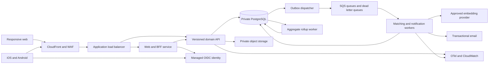

# 03 — Architecture, identity, security and infrastructure

## 1. Proposed solution architecture

Use a TypeScript monorepo, responsive React/Next.js web client and Expo/React Native iOS/Android client. Keep web/native presentation separate; share domain types, API clients, validation, localization and semantic tokens. Use a NestJS modular API and a separate worker built from the same repository. PostgreSQL is the system of record. These are proposed choices requiring the regional/vendor and team-capability gates in document 08; do not silently treat them as existing infrastructure.

Requests from native clients go directly to `/v1`; browser domain calls go through the same-origin BFF. The BFF holds OAuth tokens server-side and forwards a validated identity context to the API using access tokens; it must not invent or accept user/role headers from clients. The domain API remains the authorization boundary. Edge caching applies to static assets and safe public event metadata only; authenticated responses use `Cache-Control: private, no-store`.

### Module ownership

| Module | Owns | Dependencies and boundary |
|---|---|---|
| Identity | IdP identity binding, app sessions, account lifecycle | No event authorization in token claims alone |
| Organizations | Organization owners, staff membership and invitations | Owner/admin actions audited |
| Events | Event lifecycle, access credentials, assignments, admission | Capacity checks in DB transaction |
| Profiles | Event profiles, taxonomy, goals, style consent | Emits versioned profile-change events |
| Matching | Eligible candidates, vectors, ranks and explanations | Reads sanitized profile projection; never contacts |
| Connections | Requests, connections, contact grants | Rechecks membership, blocks and lifecycle on each transition |
| Trust | Blocks, reports, suspensions, restricted evidence | Least-privilege moderation interface |
| Analytics | Definitions, first-party events, aggregate rollups | No user-level organizer exports |
| Notifications | In-app inbox, email deliveries and preferences | Transactional outbox; no business state owned here |
| Privacy | Export, erasure, retention and consent journal | Coordinates purge and deletion tombstones |

Keep cross-module writes behind explicit domain service methods in the same database transaction. Use an outbox for asynchronous side effects. Do not introduce a service mesh, Kafka, GraphQL, custom identity server or Kubernetes in the MVP. Split a service only after measured independent ownership, scaling or isolation requirements justify it.

### Architecture decisions and trade-offs

| Decision | Rationale | Cost / rejected alternative | Revisit trigger |
|---|---|---|---|
| Modular monolith + worker | Fast transactions and a small deployment surface | Requires disciplined module boundaries; microservices add network consistency work | Independent teams or measured bottleneck |
| Next.js web and Expo mobile | Web organizer workflows and native attendee apps with shared TypeScript | Two UI implementations; universal rendering can compromise desktop/native semantics | Team skill review or native module incompatibility |
| NestJS API | Explicit module boundaries, validation and guards | More framework ceremony than minimal Fastify | Keep framework if team demonstrates maintainability |
| PostgreSQL with pgvector | Transactions, tenant constraints, semantic retrieval in one store | Index tuning and vector extension availability; dedicated vector DB adds duplication | Vector workload materially harms transactional p95 |
| Managed Cognito OIDC, hosted authentication | Avoid custom credential handling; AWS integration | Hosted UI customization and provider dependency | Required regional feature or enterprise identity unavailable |
| ECS Fargate + RDS Multi-AZ instance | Managed container execution and database failover without cluster operations | Higher baseline cost than single-instance/serverless prototype | Cost/capacity evidence; never downgrade safety silently |
| SQS + transactional outbox | Durable retries with operationally simple queue | At-least-once delivery requires deduplication | Throughput/replay requirements exceed queue design |
| Versioned learned embeddings + explicit ranking | Semantic relevance without model authority over permissions | Provider cost, bias and evaluation work; keywords alone miss synonyms | Offline/pilot evidence of no lift → remove embedding dependency |
| Poll inbox, transactional email | Reliable baseline without push permissions | Less immediate than push; polling load | Missed-request data justifies push investment |
| Single primary region, tested regional restore | Simple data ownership and operations | No instant regional continuity | Contractual RTO lower than measured restore time |

Pin supported runtime, dependency and model versions at implementation kickoff; use supported Node LTS and an RDS-supported PostgreSQL major with verified pgvector support. Do not use floating `latest`, preview SDKs or invented version numbers. ORM recommendation: Prisma for standard access, parameterized SQL migrations/queries for RLS and vectors; one migration ledger only. Validate driver/transaction compatibility before selection. No ORM schema is a substitute for database constraints.

## 2. Authentication and authorization

### Authentication design

Use managed verified-email sign-up/sign-in and recovery; no app-owned passwords. Staff must enroll in provider-supported TOTP MFA before any privileged action. Offer provider-managed passkeys only if the selected region/tier supports the required flow and it is tested; not an MVP dependency. Social login is future scope rather than a partial integration.

Use OIDC authorization code with PKCE S256, exact registered redirect URIs, state, nonce and issuer checks. Native uses the system browser and claimed HTTPS universal/app links. Never embed a client secret in a mobile binary. Web uses a confidential BFF; tokens remain server-side, cookie is `__Host-` prefixed, Secure, HttpOnly, SameSite=Lax, path `/`, no domain. Protect all cookie-authenticated mutations with CSRF token and Origin verification. No token in browser localStorage. Follow [OAuth Security BCP](https://www.rfc-editor.org/rfc/rfc9700.html) and [Browser-Based Applications BCP](https://www.rfc-editor.org/rfc/rfc10017.html).

Native access token remains in memory; refresh token in OS-protected storage, such as [Expo SecureStore](https://docs.expo.dev/versions/latest/sdk/securestore/), with backup/uninstall and device-lock behavior verified. No sensitive contacts in persistent client cache. Proposed access lifetime 10 min, rotating refresh lifetime 30 days, reuse detection and revocation where supported. API checks local account active state for each request, so local suspension/deletion is immediate despite token validity. Logout revokes app session and refresh token, clears device secrets and local sensitive state; previously issued bearer tokens expire within bounded TTL unless a local revocation marker rejects them sooner. Staff step-up age <=15 min for publish, staff/owner changes, exports and credential rotation. Do not promise immediate provider-wide revocation without verification.

API verifies signature, allowed algorithm, issuer, audience or provider-specific client binding, token use, expiry and allowed app client IDs. Do not accept ID tokens as API access tokens. JWKS refresh is bounded and cached, with safe unknown-key refresh; failures deny auth. User key is `(issuer, subject)`, not mutable email. Never auto-link identities based solely on email. Managed-provider recovery flow plus local session revocation handles compromised accounts.

### Authorization matrix

| Resource/action | Attendee | Assigned planner | Assigned event organizer / organization owner | Event moderator | Platform operator |
|---|---|---|---|---|---|
| Event safe metadata | Published only | Assigned | Owned/assigned | Assigned | Audited support |
| Draft details/edit logistics | No | Yes | Yes | No, unless also staff | Break-glass only |
| Publish/cancel/rotate access | No | No | Yes | No | Break-glass only |
| Staff delegation / org ownership | No | No | Organization owner only | No | No routine access |
| Admission and safe member statuses | Own status | Assigned | Assigned | Assigned | Audited support |
| Recommendations / public event profile | Eligible own event | Only if enrolled attendee | Only if enrolled attendee | Restricted report evidence only | No routine access |
| Private profile/style/goals | Self | No | No | No | Time-limited incident basis only |
| Requests/contacts/feedback | Pair participant with state/consent checks | No | No | Report-specific sanitized evidence | Explicit audited investigation |
| Aggregate analytics/export | No | Assigned | Assigned | No, unless also staff | Operational aggregate only |
| Report resolution/suspend | Own report/block only | No unless moderator | No unless moderator | Assigned event only | Platform-wide safety role |
| Account export/delete | Self, reauthenticated | No | No | No | Erasure job role only |

Organization owner can appoint event organizers, planners and moderators; invitations are verified-email bound, hashed, expire in 72 h and are single-use. An existing staff member can hold multiple explicit roles. Planner is never organization admin by implication. Object IDs are identifiers, not capabilities. User-supplied `organization_id`, `event_id` and nested resource IDs must be resolved through membership and relationship checks.

Enforce application policy plus PostgreSQL RLS for event-owned tables. Set actor and event context with transaction-local settings after auth, never from raw request headers; ensure connection pooling cannot retain context. Runtime DB role must neither own tables nor have BYPASSRLS; use FORCE RLS where appropriate, separate migration role and tested owner exceptions. PostgreSQL documents [row security behavior and policy limits](https://www.postgresql.org/docs/17/ddl-rowsecurity.html); RLS does not replace field projection, authenticated context or module permissions. Worker/service roles get purpose-specific policies and cannot bypass isolation through a shared superuser credential.

## 3. Security architecture

### Trust boundaries and threat controls

| Threat / boundary | Controls | Required evidence |
|---|---|---|
| Internet → public join surface | WAF, input bounds, generic invalid/expired response, scoped rate limits, no indexable private event pages | Enumeration/brute-force test |
| Attendee → other tenant/person | Object and property authorization, RLS, composite FKs, allowlisted DTO fields | Two-tenant IDOR/property fuzz tests |
| Browser → cookie session | BFF, CSRF, exact origin, CSP, output encoding, secure cookies | CSRF/XSS tests and header inspection |
| Device → native API | PKCE, secure storage, server-side validation, no bundled secrets | Binary inspection and auth replay tests |
| Profile text → embedding provider | Sanitized event-specific text only, explicit processing notice, approved data terms, no tools or action execution | Provider payload inspection and deletion plan |
| Worker → database/queue | IAM scoped roles, idempotent jobs, version checks, dead letter handling | Retry/replay and stale-version tests |
| Staff → personal information | Aggregates, suppressed small groups, no contact exports, audited step-up | Privacy review and role matrix tests |
| Untrusted image/URL | Presigned upload limits, signature/magic-byte verification, decode/reencode, malware/quarantine checks, no server URL fetching | Polyglot/image-bomb/SSRF tests |
| CI → production | Short-lived OIDC credentials, protected environment, immutable signed artifact, least privilege | Pipeline/IAM review |
| Backup → deleted data | Encrypted restricted backups, deletion ledger replay on restore, isolated restore before traffic | Recovery plus erasure drill |

Rate limits are proposed starting controls: join resolution 5 failed/minute per IP and credential fingerprint, escalating challenge/backoff; event discovery/joins also bounded per account; requests 20/day/event and 5/minute/account; general authenticated API 120/minute/user. Shared venue IPs require composite account/device/route signals; do not lock an entire conference behind one NAT. ALB/WAF protects coarse boundaries; transactional database quota counters enforce critical per-user limits without requiring Redis initially. Load-test contention and return `Retry-After`. Successful legitimate bursts must be tested.

Access tokens for event links use >=128 bits CSPRNG entropy; manual codes use eight unambiguous Base32 characters, generated globally uniquely while active. Store HMAC digests using a secret pepper (short codes need protection against offline enumeration), never plaintext in analytics/logs. Return credentials at generation/rotation; staff can generate a new set if no longer available locally. Public token resolution yields safe metadata, not membership, and admission still requires identity plus policy. QR is only an encoding, not another security factor.

Use TLS externally and DB TLS with certificate verification internally, encryption at rest with KMS, per-environment secrets in Secrets Manager, least-privilege IAM task roles, no public DB IP. Sensitive contacts and raw assessment fields additionally use envelope encryption with key version metadata; searchable public fields are deliberately separate. Never expose ciphertext/key material to analytics. Disable HTML in bios/introduction/feedback. HTTPS links are validated and opened safely; fetching remote previews is deferred. Apply email verification to selectable email and phone ownership verification before exposing a phone as verified; if phone verification provider is not approved, omit phone exchange and document that launch choice rather than fake verification. Phone remains optional.

### Privacy and retention baseline (requires legal validation)

Separate service terms, networking consent, style-processing consent and optional telemetry choice. Do not bundle optional consent into admission. Keep version, timestamp, purpose and withdrawal record; no raw answers in consent audit. Withdrawal immediately removes matching use and triggers derived-vector invalidation. The system must work with taxonomy-only matching if optional provider processing is refused.

Proposed retention: event-specific profile, vectors, requests, contacts/grants and feedback deleted 90 days after networking close; notifications 30 days; raw behavioral analytics 30 days; security logs 90 days; aggregate irreversible statistics 13 months. Account retained while active and reviewed after 12 months inactivity with notice. Backups expire after 35 days. Restrict evidence for open abuse reports to 180 days after resolution unless a documented legal hold applies; holds are scoped, time-bounded and reviewed. Retention is configurable downward by policy; prolonging requires purpose/legal review.

Account deletion: immediate access disable and session revocation, stop discovery/notifications, enqueue erasure, purge active stores within 30 days (proposed service commitment), destroy/redact contact and assessment data, remove vectors/object assets/IdP binding, delete raw pseudonymous analytics mappings and schedule backup expiry. Keep minimum deletion tombstone to prevent resurrection on restore, with expiry after the last possible backup. Audit records pseudonymize actors unless legally necessary. Export contains own data only; incoming contacts are not exported in bulk. Prior recipient downloads cannot be erased by the platform. Region and applicable laws are discovery decisions; this document makes no automatic GDPR/NDPA/other compliance claim.

Use OWASP [ASVS 5.0](https://owasp.org/projects/asvs) Level 2 as a verification baseline with justified applicability mapping and [API Security Top 10](https://api-security.owasp.org/editions/2023/en/0x03-introduction/) as threat prompts. Neither list is a certification. External security assessment and incident-response exercise are preproduction gates.

## 4. Cloud infrastructure design

Recommended provider: AWS, contingent on region, contractual processing and cost gates. Separate development, staging and production AWS accounts. Terraform owns VPC, IAM, security groups, ALB, ECS, RDS, queues, storage, WAF, DNS, secrets metadata, alarms and backup policies. No secrets committed to state inputs or repository; encrypted remote state, locking, limited readers and reviewed plans.

Production: one regional VPC across at least two AZs; private application subnets and private database subnets. Public ALB only; RDS PostgreSQL Multi-AZ **DB instance** with standby (not the three-instance Multi-AZ cluster product). ECS API/BFF at least two healthy tasks distributed across AZs, matching/notification workers separately scalable. CloudFront fronts web assets and HTTPS application routing with explicit cache policies. S3 buckets private, versioned, encrypted, blocked public access; avatars served through authorized short-lived delivery links. No public health endpoint exposing internal topology. Configure liveness vs readiness checks separately and graceful connection draining.

Networking: security groups permit only intended service edges; DB ingress from API/worker roles' security groups. Bound egress via endpoints where available and controlled NAT otherwise. Capture flow logs without application payloads. No SSH; incident access via managed audited session tooling. Regional SES transactional email with sandbox exit and sender DNS validation tested before pilot. Embedding provider is approved in-region; do not route raw profiles to an unapproved geography.

Backups: RDS automated backups/PITR 35 days, KMS-protected snapshots, object lifecycle, encrypted backup copies in an approved recovery region/account if geography policy permits. [RDS PITR restores a new DB instance](https://docs.aws.amazon.com/AmazonRDS/latest/UserGuide/USER_PIT.html); recovery must switch application configuration and replay deletion tombstones before admitting traffic. Monthly restore exercises measure RPO/RTO; prelaunch regional exercise mandatory. If cross-region copies are prohibited, revise regional-failure objectives explicitly and do not claim the original target.

Scaling: API target CPU 60% plus request latency signal, bounded min/max task counts; workers scale on queue age/backlog. DB connection pool budget is explicitly split across API/BFF/worker maxima with headroom; BFF does not need a separate domain-data pool. Bound worker concurrency to DB/provider quotas. Initial candidate retrieval is bounded; see matching design. No cache or read replica until measured need; evaluate RDS Proxy only if connection churn requires it. Hot-event admission counters use row locks and capacity transactions, tested for contention.

Cost planning is a phase-four deliverable, not an invented dollar quote. Model monthly cost = minimum Fargate + ALB/WAF + RDS/backup/storage + NAT/egress + IdP active users + embedding tokens + emails + observability + mobile builds/store accounts. Provide idle/pilot/peak estimates from current regional calculator inputs, include support/tax where applicable, set an approved budget B and 50/80/100% alerts, cap model refreshes and log volume. Do not launch with B unresolved.
