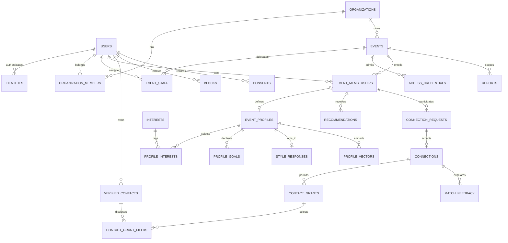

# 04 — Database schema and ERD

## 1. Conventions and tenancy

This is the logical PostgreSQL schema contract, not an executed migration. UUID primary keys; UTC `timestamptz` for instants; IANA timezone string retained on events. Fields are NOT NULL unless marked `?`. Mutable rows carry `created_at`, `updated_at`, `version integer >=1`; append-only rows carry `created_at`. APIs use optimistic versions for user-edited resources. Store secrets/contacts/style answers encrypted or hashed as specified, never disguised as ordinary text fields.

Event-owned tables carry `event_id` even when inferable; use composite FKs `(event_id, membership_id)` → event_memberships `(event_id,id)` to prohibit cross-event references. Organization event membership must be consistent through composite organization/event FKs. A user can join many events. Global account fields are never used to silently expose an event profile elsewhere. Denormalized worker projections contain only approved fields and are versioned.

## 2. Entity relationship diagram

Two endpoints of a request/connection/recommendation each reference a membership. ERD omits repeated endpoint edges for readability; dictionary and constraints below are authoritative.

## 3. Core dictionary

| Table | Fields beyond standard timestamps | Constraints / access |
|---|---|---|
| users | id, display_name?, status(active/deleting/suspended/deleted), adult_attested_at?, locale, last_active_at? | Private account; no global public profile; deletion replaces optional identifying fields |
| identities | id, user_id FK, issuer, subject, verified_email_ciphertext?, provider_status | UNIQUE(issuer,subject); identity email separate from shared contact |
| app_sessions | id, user_id, session_hash, provider_refresh_ciphertext?, expires_at, revoked_at?, auth_time, mfa_time? | Web sessions only; token/session secrets absent from logs |
| verified_contacts | id, user_id, kind(email/phone/work_url), value_ciphertext, verification_status, verified_at?, key_version, revoked_at? | Email/phone verified before share; work_url validated HTTPS and labeled self-supplied |
| organizations | id, name, status | Tenant root; no billing in MVP |
| organization_members | id, organization_id, user_id, role(owner/member), status | UNIQUE(org,user); protect last active owner transactionally |
| events | id, organization_id, title, description, category, timezone, starts_at, ends_at, admission_opens_at, admission_closes_at, networking_opens_at, networking_closes_at, capacity, admitted_count, admission_mode(shared/approval), status, data_expires_at, published_at?, cancelled_at? | Category enum: technology_conference/business_conference/startup_summit/corporate_networking; date constraints; capacity>0; UNIQUE(org,id) |
| event_staff | id, organization_id, event_id, user_id, role(organizer/planner/moderator), active | UNIQUE(event,user,role); FK staff user must be active organization member |
| staff_invitations | id, organization_id, event_id, invited_email_digest, role, token_hash, expires_at, consumed_at?, invited_by | Single use, verified-email bound; encrypted destination only for delivery |
| access_credentials | id, event_id, link_digest, code_digest, pepper_version, expires_at, revoked_at?, created_by | Unique active digests; code/link share lifecycle; plaintext returned once |
| event_memberships | id, event_id, user_id, status, admitted_at?, left_at?, suspended_at?, networking_enabled, consent_version?, consented_at?, referral_id? | UNIQUE(event,user), UNIQUE(event,id); networking false default; status checks enforced |
| event_profiles | id, event_id, membership_id, display_name(1–80), headline(1–120), company?(<=120), bio?(<=1000), experience_level?(early/mid/senior/prefer_not), experience_preference?(peer/learn/share/any), avatar_asset_id?, eligible_version? | UNIQUE(membership); no email/phone/style/public age; completeness derived from required fields |
| interests | id, taxonomy_version, slug, label, active | UNIQUE(version,slug); retirement preserves historical explanation snapshots |
| profile_interests | event_id, profile_id, interest_id | PK(profile,interest); 3–10 for eligibility; maximum enforced at transaction/service layer |
| goal_topics | id, taxonomy_version, slug, label, active | Topics include mentorship, hiring, role_seeking, partnerships, fundraising, investing, customers, solutions, peers; topic compatibility is versioned data |
| profile_goals | id, event_id, profile_id, direction(seek/offer), topic_id, detail?(<=240), public_summary, priority(1–3) | 1–3 for eligibility; UNIQUE(profile,direction,topic); public_summary previewed by user; detail private and excluded from public DTO |
| style_responses | id, event_id, profile_id, instrument_version, answers_ciphertext, consent_id, key_version | UNIQUE(profile); four declared preferences; deleted on withdrawal |
| profile_vectors | id, event_id, profile_id, model_version, input_hash, profile_version, embedding vector(approved dimension), processing_consent_id, valid_until | UNIQUE(profile,model_version); dimension fixed by approved model in real migration; never mix spaces |
| match_runs | id, event_id, actor_membership_id, algorithm_version, taxonomy_version, model_version?, input_version, mode(semantic/fallback), completed_at?, status | Traceability without raw text; deterministic seed if randomized exploration used |
| recommendations | id, event_id, run_id, actor_membership_id, candidate_membership_id, rank, score_internal, reason_codes, reason_public_facts, candidate_profile_version, expires_at, invalidated_at? | UNIQUE(run,candidate), rank>0; actor != candidate; public facts exclude private assessment |
| recommendation_impressions | id, event_id, recommendation_id, viewer_membership_id, client_event_id, viewed_at | UNIQUE(viewer,client_event_id); source for exposure, subject to retention |
| connection_requests | id, event_id, sender_membership_id, receiver_membership_id, pair_low, pair_high, status, introduction?(<=240), recommendation_id?, delivered_at?, responded_at?, expires_at | Canonical pair ordering; at most one pending/event unordered pair via partial UNIQUE; recommendation must belong to sender/event/pair |
| connections | id, event_id, request_id, member_low, member_high, status(active/ended), connected_at, ended_at? | UNIQUE(event,member_low,member_high); UNIQUE(request); accepted request FK; both memberships same event |
| contact_grants | id, event_id, connection_id, owner_membership_id, granted_at, revoked_at? | One current grant per connection/owner; owner must be endpoint; history audited |
| contact_grant_fields | grant_id, contact_id, contact_version | PK(grant,contact); contact must belong to grant owner; contact version mismatch disables disclosure |
| match_feedback | id, event_id, connection_id, author_membership_id, rating smallint, meaningful_outcome boolean?, note_ciphertext?, key_version | UNIQUE(connection,author); rating BETWEEN 1 AND 5; author must be endpoint; private |
| blocks | id, blocker_user_id, blocked_user_id, revoked_at? | No self; unique active directed pair; either direction removes both from all visibility |
| reports | id, event_id, reporter_membership_id, subject_membership_id, category, detail_ciphertext?, evidence_reference?, status(open/in_review/resolved), assigned_moderator_id?, resolution_code?, resolved_at? | Same-event endpoints; limited report evidence, no blanket profile access |
| consents | id, user_id, event_id?, purpose, policy_version, granted_at?, withdrawn_at?, lawful_basis_record? | Append-only purpose transitions; no answers in journal |
| assets | id, owner_user_id, event_id?, object_key, content_hash, media_type, bytes, status(quarantine/ready/rejected), expires_at? | Only validated ready images display; private storage key |
| notifications | id, user_id, event_id?, type, resource_id?, read_at?, expires_at | Authorization rechecked on destination; no embedded contacts |
| delivery_attempts | id, notification_id, channel, dedupe_key, provider_id?, status, attempts, next_attempt_at?, last_error_code? | UNIQUE(dedupe_key,channel); provider retries bounded |
| share_referrals | id, event_id, referrer_membership_id, token_digest, expires_at | No admission authority; attribution only; UNIQUE(event,referred user) enforced on membership |
| outbox_events | id, aggregate_type, aggregate_id, aggregate_version, event_type, payload_minimal_json, dispatched_at?, attempts | Written with domain transaction; no secret/private raw profile payload |
| consumed_events | consumer_name, event_id, consumed_at | PK(consumer,event); transactional dedupe |
| idempotency_keys | principal_id, route_scope, key_hash, request_hash, status, response_reference?, expires_at | UNIQUE(principal,scope,key); 24 h proposed; encrypted references, not contacts payload |
| audit_log | id, actor_pseudonym, event_id?, action, target_type, target_id, outcome, request_id, reason?, occurred_at | Append-only service writer; no raw personal fields; restricted readers |
| analytics_events | id, pseudonymous_user_key?, event_id, name, schema_version, occurred_at, received_at, dedupe_key, allowed_properties | Allowlisted schema; no bios, contacts, assessment or free text |
| event_daily_metrics | event_id, day_utc, metric_version, counters_json, watermark | PK(event,day,version); organized metric definitions and suppressed output |
| privacy_jobs | id, user_id?, kind(export/delete/retention), status, requested_at, completed_at?, failure_code?, expires_at? | Explicit state machine, retries and operator alert |
| deletion_tombstones | pseudonymous_subject_hash, erased_at, backup_expiry_at, scope | Minimal restore erasure ledger; no raw identity |

An embedding vector dimension is intentionally not invented before provider/model approval. Phase four must record a concrete model ID, dimensions, regional availability and migration; an unresolved dimension blocks semantic implementation, not a license to create a dummy vector.

## 4. Integrity and indexes

- Foreign keys use `ON DELETE RESTRICT` on core business records; privacy jobs delete/redact in controlled dependency order. Cascades are permitted only on owned subordinate rows after review. No blanket soft deletion retaining private data forever.
- Index active memberships `(event_id,status,networking_enabled,id)`, staff `(user_id,event_id,active)`, requests `(event_id,receiver,status,created_at DESC)` and sender equivalent, recommendations `(event_id,actor,invalidated_at,expires_at,rank)`, outbox `(dispatched_at,created_at)` filtered pending, jobs `(status,next_attempt_at)`, feedback `(event_id,connection_id)`.
- Add partial canonical-pair unique indexes for pending requests and active blocks; `CHECK(member_low < member_high)`. Crossed sends lock/canonicalize pair, return existing incoming request, never silently accept. Acceptance locks request, validates all eligibility again and atomically inserts connection plus outbox event.
- Capacity transaction locks event row, confirms admission still open, increments admitted_count only for a new active admission, inserts/activates membership, commits once. Leaving/suspension releases capacity per ratified policy; proposed policy releases active seat. Reconcile counter against active memberships daily and alert drift.
- `event_staff` and `organization_members` consistency on removal requires transaction plus FK/application guard. Revocation is effective before notification delivery.
- Vector index choice depends on tests: at <=5,000/event start with exact distance over indexed event subset; add HNSW only with verified event-filter recall and performance. Do not query a global approximate index without filtering and assume tenant isolation.
- TTL/date enforcement uses database UTC clock and query predicates, not scheduler timeliness. Every contact read checks bilateral grants, field ownership/version, both memberships, blocks, connection status, account status and event expiry.
- Changes to goals/interests/style/networking consent bump profile eligibility version and invalidate vectors/recommendations. Candidate/source versions are checked at delivery and read; stale data may be recomputed but cannot bypass authorization.

## 5. Migration and recovery approach

Version SQL changes through one reviewed migration tool. Expand/add fields and indexes first, backfill in resumable batches, deploy dual-read/write only where required, observe, then remove in a later release. Concurrent indexes use the appropriate nontransactional migration step. Avoid table rewrites or long locks during live conferences. Snapshot and restore rehearsal for destructive migration; never rely on migration rollback to recover lost data.

Seed taxonomies as versioned production configuration, with actual reviewed labels and compatibility rules. Synthetic people belong only in isolated dev/test/pilot rehearsals clearly labeled synthetic. No production fake connections, scores or feedback. Data QA checks orphan counts, cross-event constraints, duplicate pairs, aggregate reconciliation and actual erasure in derived tables.
